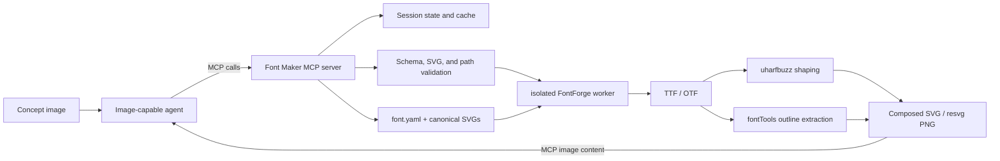

# Font Maker MCP: product architecture and delivery plan

## Product statement

Font Maker MCP is a stateful, agent-facing font workshop built on FontForge:

1. A person or agent creates a reference image showing a new font idea.
2. An image-capable agent draws one SVG per glyph using a shared metric template.
3. The agent uses MCP tools to import and clean glyphs, adjust metrics and spacing, define kerning and ligatures, and inspect rendered previews.
4. The server validates and exports installable font files.

FontForge is the compilation backend. Font Maker supplies the durable project model, safe SVG conventions, structured diagnostics, previews, and goal-oriented operations that make the backend efficient for agents.

Version 1 targets one static, monochrome outline style. Variable fonts, color fonts, bitmap strikes, hinting authoring, and complex-script mark positioning are later work.

## State model

MCP provides convenient session state, but the server must not keep the only copy of a font in memory.

- **Durable state:** `font.yaml`, canonical SVGs, and reference images.
- **Session state:** open project IDs, current revision, recent preview settings, backend capability cache, and build cache keys.
- **Build artifacts:** generated fonts, preview images, shaping reports, and optional SFD diagnostics.
- **Recovery:** after a restart, opening the project reconstructs all meaningful state from disk.

An `open_font_project` call returns the persistent project UUID from `font.yaml` and a content-derived revision hash. Every durable mutation requires `expected_revision`; a stale writer receives the current revision instead of overwriting newer work.

## Product principles

1. **The project is the source of truth.** SVGs and a versioned manifest are durable; generated SFD and font files are artifacts.
2. **MCP tools represent user goals.** Expose glyph import, spacing, kerning, ligatures, preview, and export—not arbitrary FontForge scripting.
3. **Preview the actual font.** Render a freshly generated font with a shaping engine so previews exercise real GSUB and GPOS behavior.
4. **Do not infer typography from accidental bounds.** Baseline, ascender, descender, cap height, x-height, scale, advances, and sidebearings are explicit.
5. **Keep FontForge isolated.** Build in a bounded worker process so malformed input or a native crash does not terminate the MCP server.
6. **Make iteration cheap.** Inspect → mutate → preview → inspect should be fast, transactional, and easy to recover.

## End-to-end agent workflow

### 1. Establish the concept and coordinate system

The concept image is a reference artifact in version 1; the server does not trace it automatically. The image-capable agent reads the visual language and establishes project metrics.

```json
{
  "tool": "create_font_project",
  "arguments": {
    "path": "./paper-sans",
    "family_name": "Paper Sans",
    "style_name": "Regular",
    "reference_image": "./concept.png",
    "metrics": {
      "units_per_em": 1000,
      "ascender": 800,
      "cap_height": 700,
      "x_height": 500,
      "descender": -200
    }
  }
}
```

The tool creates a manifest, conventional directories, and a guided SVG template. The default is the [glyph template](../templates/glyph-template.svg): one shared 1000×1000 canvas, one canonical baseline at SVG y=800, secondary vertical-metric guides, and an empty `#glyph` group.

### 2. Add, inspect, and normalize SVG glyphs

The agent makes SVGs from the concept using the shared template, then imports a batch:

```json
{
  "tool": "upsert_glyphs",
  "arguments": {
    "project_id": "project_...",
    "glyphs": [
      {
        "name": "A",
        "svg_path": "./incoming/A.svg",
        "codepoints": ["U+0041"],
        "advance_width": 680
      },
      {
        "name": "V",
        "svg_path": "./incoming/V.svg",
        "codepoints": ["U+0056"],
        "advance_width": 680
      }
    ],
    "normalize": true
  }
}
```

Normalization copies canonical path-only SVGs into the project; it never scales each glyph to its individual bounding box. The server strips `#fontmaker-guides[data-fontmaker-ignore="true"]` and imports artwork from `#glyph`.

### 3. Refine metrics, kerning, and ligatures

The agent uses focused mutations followed by rendered evidence:

- set advances and sidebearings;
- define kerning groups and pair values;
- add `liga`, `rlig`, or `dlig` substitutions;
- render representative text with alignment guides and compare feature toggles;
- inspect shaping output when a result is ambiguous.

Each mutation returns the new project revision, affected objects, warnings, and suggested preview strings.

### 4. Validate and export

`validate_font_project` checks the project and optionally performs a temporary build. `build_font` writes requested artifacts and returns paths, sizes, hashes, diagnostics, backend version, and project revision.

## Architecture



### Components

```text
MCP transport
  -> tool handlers
    -> typed font-project service
      -> atomic project store
      -> SVG inspector/normalizer
      -> FontForge worker adapter
      -> HarfBuzz preview adapter
      -> artifact registry
```

Use the official Python MCP SDK for the server and a typed Python domain model. Begin with local STDIO MCP: the agent and server share a workspace, no authentication is necessary, and filesystem artifacts remain directly inspectable.

The server returns initialization instructions containing the shared workflow: open or create a project, inspect before mutation, validate after importing glyphs, and preview before export. The most important guidance stays in the first 512 characters.

### FontForge process boundary

The long-lived MCP server must not keep FontForge loaded. It launches a short-lived worker:

```text
fontforge -lang=py -script fontforge_driver.py request.json result.json
```

The worker receives sanitized pen commands, metrics, and layout declarations—not SVG paths or executable scripts—generates fonts, writes a structured result, and exits. The parent enforces time and POSIX resource limits, captures stdout/stderr, and maps failures to stable error codes.

The PyPI binding was not available for the supported Python/platform combination, so v0.1 pins the separately installed FontForge executable to internal version `20251009`. `fontmaker doctor` reports the discovered executable and rejects a different compiler version. macOS development uses the checked-in `Brewfile`; a matching Linux distribution is a release prerequisite.

### Project layout

```text
paper-sans/
|-- font.yaml
|-- glyph-template.svg
|-- glyphs/
|   |-- A.svg
|   |-- V.svg
|   `-- f_i.svg
|-- references/
|   `-- concept.png
|-- .fontmaker/
|   `-- cache.sqlite3
`-- build/
    |-- previews/
    `-- fonts/
```

## Durable project format

Use one human-editable, schema-versioned `font.yaml`. Server writes are normalized, transactional, and atomic.

```yaml
schema_version: 1
project_id: 72bea0aa-c9f8-4b63-a05b-e37b5c954db3

font:
  family_name: Paper Sans
  style_name: Regular
  version: "1.000"

metrics:
  units_per_em: 1000
  ascender: 800
  cap_height: 700
  x_height: 500
  baseline: 0
  descender: -200
  line_gap: 0

references:
  concept: references/concept.png

svg:
  view_box: [0, 0, 1000, 1000]
  y_axis: down
  baseline_y: 800
  scale: 1
  translate_x: 0
  translate_y: 0

glyphs:
  A:
    source: glyphs/A.svg
    codepoints: [U+0041]
    advance_width: 680
  V:
    source: glyphs/V.svg
    codepoints: [U+0056]
    advance_width: 680
  f_i:
    source: glyphs/f_i.svg
    codepoints: []
    advance_width: 520

kerning:
  groups:
    A-left: [A, Aacute]
  pairs:
    - { left: "@A-left", right: V, value: -80 }

ligatures:
  - feature: liga
    sequence: [f, i]
    replacement: f_i

build:
  formats: [ttf, otf, woff2]
  output_dir: build/fonts
  remove_overlaps: true
  correct_contour_direction: true
```

Arbitrary feature-file execution is intentionally outside v1. Layout is represented by typed, inspectable kerning and ligature declarations so agents cannot bypass confinement or silently redefine generated lookups.

## SVG contract and template

SVG has no inherent typographic baseline. Font Maker uses a shared canvas and explicit conversion:

```text
font_x = (svg_x + translate_x) * scale
font_y = (baseline_y - svg_y + translate_y) * scale
```

All glyphs share the same viewBox, baseline, y-axis direction, and units-to-font-unit scale. Advance width lives in metadata and is not inferred from canvas width. Per-glyph transform overrides are possible but produce warnings when overused.

Canonical input requirements:

- closed, filled monochrome outlines in `#glyph`;
- strokes expanded before final import;
- transforms flattened into coordinates;
- no raster images, external resources, masks, filters, or SVG text in artwork;
- no tight-cropping to individual glyph bounds;
- intentional overshoot beyond flat alignment zones is preserved;
- economical curves without stray or microscopic segments.

## MCP tool surface

Tools use strict input/output schemas and accurate read-only/destructive annotations. Results include concise `content` plus `structuredContent` with stable identifiers and revisions.

| Tool | Purpose | Durable write |
| --- | --- | --- |
| `create_font_project` | Create a project, explicit metrics, reference link, and SVG template. | Yes |
| `open_font_project` | Open/recover a project and return `project_id`, revision, summary, and capabilities. | Session only |
| `get_font_project` | Return normalized metrics, glyph inventory, layout rules, diagnostics, and revision. | No |
| `set_font_metrics` | Change shared vertical metrics and regenerate the template without rescaling glyphs. | Yes |
| `upsert_glyphs` | Transactionally import/update SVG glyphs and optional metrics. | Yes |
| `remove_glyphs` | Remove glyphs after reporting dependent rules. | Yes, destructive |
| `set_glyph_metrics` | Set advances, sidebearings, and permitted per-glyph overrides. | Yes |
| `suggest_spacing` | Run FontForge auto-width/auto-kern on a disposable clone and return a revision-bound proposal. | Cache only |
| `apply_spacing_proposal` | Apply a reviewed proposal only when its base revision remains current. | Yes |
| `set_kerning` | Upsert/remove pair values and group membership transactionally. | Yes |
| `set_ligatures` | Upsert/remove `liga`, `rlig`, and `dlig` rules. | Yes |
| `validate_font_project` | Validate schema, SVGs, metrics, references, layout, and optional temporary build. | No durable write |
| `shape_text` | Return glyph names/IDs, clusters, advances, offsets, and active features. | No |
| `preview_font` | Render compiled text with optional metric and advance-box guides. | Artifact/cache only |
| `build_font` | Generate requested font formats with metadata and hashes. | Artifacts only |

Use batch inputs for glyphs and kerning so an agent can make coherent changes in one call. Do not expose `run_fontforge_script`; it would bypass the project model, validation, confinement, and safety annotations.

### Stateful project handles

`project_id` is an opaque handle bound to:

- canonical project path;
- current revision;
- last validated revision;
- recent preview settings;
- cached build/preview artifacts keyed by content hash;
- backend capabilities used for that project.

All durable mutations require `expected_revision`. On mismatch, return a conflict with the current revision and changed sections rather than overwriting.

### Preview results

`preview_font` returns:

- an MCP image content block for PNG when practical;
- an artifact path and MIME type;
- the project revision and build ID;
- the exact text, feature toggles, script/language/direction, font size, and PNG pixel scale;
- a compact shaping summary and any warnings.

Preview modes:

- arbitrary text as PNG and SVG;
- optional baseline, x-height, cap-height, ascender, and descender overlays;
- exact HarfBuzz glyph names, clusters, advances, offsets, and enabled features.

Use `uharfbuzz` for shaping, `fontTools` for compiled-outline extraction, and `resvg` for PNG rasterization so the image and structured trace both reflect the generated font.

## Validation, safety, and diagnostics

Diagnostics include a stable code, severity, affected glyph/rule, relevant measurements, and a suggested correction.

Checks include:

- malformed, oversized, or externally linked SVGs;
- strokes, text, raster images, masks, clipping, and unsupported transforms;
- open contours, self-intersections, wrong winding, and extreme point counts;
- inconsistent viewBox, baseline, scale, or glyph-specific transforms;
- bounds unexpectedly beyond vertical zones;
- missing/duplicate glyph names or Unicode mappings;
- implausible advances and sidebearings;
- missing ligature components/replacements;
- missing kerning glyphs/groups and conflicting pairs;
- invalid naming/metadata;
- FontForge timeouts, crashes, warnings, and unsupported formats.

Treat SVGs as untrusted. Resolve and confine all paths to configured workspace roots, reject external resources, cap file size and complexity, build in temporary directories, and enforce worker limits.

## FontForge build pipeline

1. Parse and validate the project without FontForge.
2. Create a fresh font and set naming and vertical metrics.
3. Create `.notdef`; create or validate `space`.
4. Replay sanitized, explicitly transformed outline commands into glyph slots.
5. Apply the explicit project transform, advances, and sidebearings.
6. Apply configured cleanup: overlap removal, contour direction, coordinate rounding, and extrema.
7. Create GPOS pair/class kerning lookups.
8. Create GSUB ligature lookups under requested feature tags.
9. Run FontForge validation and generate requested TTF/OTF files.
10. Convert TTF to WOFF2 with `fontTools` when requested.
11. Inspect tables and shape representative strings.

TTF, OTF, and WOFF2 are supported. WOFF2 is generated from the built TTF with the locked Brotli/fontTools stack.

## Companion CLI

Keep a thin CLI over the same project service for backend development, CI, and recovery:

```shell
fontmaker doctor
fontmaker check ./paper-sans --json
fontmaker preview ./paper-sans --text "AVATAR affine office" --scale 3 --out preview.png
fontmaker build ./paper-sans --format ttf --format otf --json
```

The CLI is not a second implementation. It calls the same typed operations used by MCP handlers.

## Licensing and attribution

FontForge identifies the complete program as **GPL-3.0-or-later**, while many individual files use the revised BSD license. The simplest distribution choice is to release Font Maker under GPL-3.0-or-later.

The repository should:

- include the full GPL-3.0-or-later text as `LICENSE`;
- add `THIRD_PARTY_NOTICES.md` naming FontForge, its contributors, license, homepage, and source repository;
- credit FontForge in the README, server metadata/instructions, companion CLI version/doctor output, and build metadata;
- retain notices for copied or modified FontForge code;
- satisfy license and corresponding-source obligations for any distributed FontForge binary or container;
- keep each user-created font's own license metadata explicit and separate from the tool repository license.

If a future edition needs a permissively licensed wrapper, obtain legal review and keep FontForge as a separately installed executable. This is engineering guidance, not legal advice.

## Design skills

Skills teach typographic judgment; MCP tools perform mechanics.

- **Font production workflow:** concept and coverage decisions, project setup, SVG batch production, feature sequencing, compiled acceptance, and release handoff.
- **Font design metrics:** shared coordinate system, baseline and vertical zones, overshoot, proportions, advances, sidebearings, and import-safe SVGs.
- **Optical spacing and kerning:** control glyphs, representative strings, sidebearing diagnosis, pair exceptions, and stable groups.
- **Ligature design:** justification, feature selection, sequence coverage, caret concerns, and surrounding texture.
- **Outline QA:** curves, extrema, winding, overlap, joins, repeated-shape consistency, and rasterized evidence.
- **Font specimen review:** systematic preview strings for rhythm, differentiation, coverage, and regression review.

Use the production workflow for end-to-end jobs, loading the focused skills only when their corresponding design phase is active. Continue refining them when realistic agent trials reveal recurring failures.

## Delivery phases

### Phase 0: backend and SVG spike — implemented

- Install pinned FontForge `20251009` and the locked `uharfbuzz` runtime.
- Import fixture SVGs for `A`, `V`, `f`, `i`, and `f_i`.
- Test explicit coordinate conversion and FontForge normalization.
- Generate TTF/OTF with one kern pair and one `liga`.
- Verify with `uharfbuzz` shaping and the compiled-outline preview renderer.
- Record supported SVG constructs and backend quirks.

Acceptance: alignment survives import, `AV` receives the requested adjustment, `fi` shapes to `f_i`, and both fonts validate and render.

### Phase 1: project core — implemented

- Initialize the Python package.
- Define the schema and typed service operations.
- Implement project discovery, atomic writes, revisions, transactions, path confinement, diagnostics, and artifact registry.
- Implement the FontForge and HarfBuzz adapters.
- Add the companion `doctor`, `check`, `preview`, and `build` commands.

Acceptance: the same operation can be invoked in-process or via CLI and produces an identical structured result.

### Phase 2: MCP server — implemented

- Register the focused tools with the official Python MCP SDK.
- Add server instructions and session-local project handles.
- Return structured results, preview image content, and accurate annotations.
- Test with the MCP inspector and Codex over local STDIO.

Acceptance: an agent can create/open a project, import fixtures, preview, mutate, validate, and export without invoking a shell.

### Phase 3: font refinement — implemented

- Implement canonical SVG normalization.
- Add compiled text previews with metric and advance-box guides.
- Add metrics, kerning groups/pairs, and ligature tools.
- Test transactionality, idempotency, shaping, and revision conflicts.

Acceptance: an agent can detect and correct a metric inconsistency, kern `AV`, add `fi`, and prove each result visually and structurally.

### Phase 4: skills, packaging, and hardening — v0.1 baseline implemented

- Forward-test the metrics skill on realistic SVG sets.
- Add focused skills only where measured agent behavior improves.
- Package the local STDIO MCP and companion CLI, with macOS as the verified native backend.
- Add Windows after validating FontForge behavior.
- Test malformed SVGs, timeouts, crashes, path traversal, and concurrent edits.
- Ship licensing and third-party source information with every distribution.

## Initial decisions

- **Primary interface:** stateful local STDIO MCP.
- **Secondary interface:** thin CLI for development, CI, and recovery.
- **Language:** Python.
- **Backend:** FontForge in a short-lived worker.
- **Durable state:** YAML plus canonical per-glyph SVGs.
- **Session state:** open project handles and revision-keyed caches.
- **Preview:** generated font shaped and rendered with HarfBuzz.
- **License:** GPL-3.0-or-later.
- **MVP:** one static monochrome style, explicit metrics, pair/class kerning, `liga`/`rlig`/`dlig`, TTF/OTF/WOFF2, and PNG/SVG previews.

## Next milestone

Run end-to-end agent trials on concept images and larger Latin glyph sets, then publish a matching FontForge `20251009` Linux distribution with corresponding-source instructions. Windows support, glyph-sheet/comparison preview modes, and deeper outline topology diagnostics follow after v0.1.
